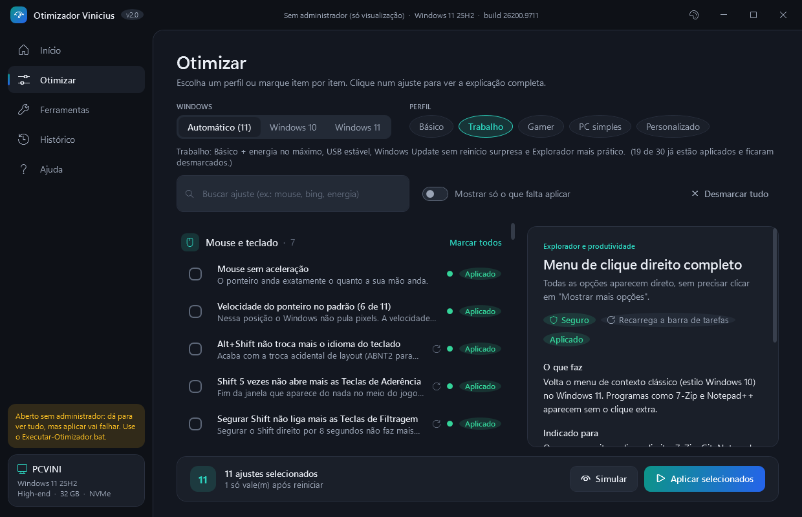

# TechPulse

Otimizador de Windows 10/11 com interface gráfica, feito em PowerShell + WPF.
Cada ajuste vem explicado em linguagem simples, mostra se já está aplicado e pode ser **desfeito individualmente**, voltando ao valor exato que existia antes.



> ⚠️ **v2.0 em teste.** A interface e a detecção foram testadas; a aplicação com administrador ainda passa pelo [plano de testes](docs/plano-de-testes.md). Use primeiro num PC de testes ou crie um ponto de restauração.

## Instalar

Baixe o **`TechPulse-Setup-x.y.z.exe`** em [Releases](https://github.com/ViniciusAPRamos/projeto-vinicius-manutencao/releases) e instale.
Na primeira vez, o Windows pode mostrar "O Windows protegeu o computador" (o instalador ainda não tem assinatura digital): clique em **Mais informações > Executar assim mesmo**.
Depois disso, o TechPulse avisa no Início quando houver versão nova e se atualiza com um clique. Em **Ajuda > Atualizações** dá para receber também as versões de teste.

## Publicar uma versão (desenvolvimento)

- Todo `git push` no `main` gera uma **versão de teste** (`versao.txt` + número do build, ex.: 2.1.0.15), publicada como pré-release.
- Para uma **versão estável**: `git tag v2.1.0` e `git push origin v2.1.0`. Depois aumente o `versao.txt` (ex.: 2.1.1) para os próximos testes.
- Local: `tools\build.ps1` monta `dist\TechPulse-Setup-<versão>.exe` (precisa do Inno Setup 6: `winget install --id JRSoftware.InnoSetup -e`).

## Como usar

1. Abra o **TechPulse** pelo Menu Iniciar (ou, na pasta do projeto, dois cliques em **`src\Executar-Otimizador.bat`**) e aceite o pedido de administrador.
2. **Início:** resumo do PC, classificação (Low/Mid/High-end) e perfil sugerido.
3. **Otimizar:** escolha um perfil (Básico, Trabalho, Gamer, PC simples) ou marque item por item. Use **Simular** para ver o que mudaria e **Aplicar** para executar.
4. Acompanhe cada item ficar verde ✓ ou vermelho ✗ (com o motivo). No final, o resumo diz se precisa reiniciar.

O menu de texto antigo (v1.1) continua em `src\Executar-Modo-Texto.bat`.

### Vários PCs iguais (empresa)

1. Num PC, marque os ajustes em **Otimizar** e clique em **Exportar** (gera um `.json`).
2. Em cada outro PC, com a pasta do otimizador: `src\Aplicar-Perfil.bat perfil.json`
   (ou `Aplicar-Perfil.bat trabalho` para um perfil pronto). Aplica sem abrir a janela e mostra o resumo.
3. Para acompanhar os PCs: `src\Inventario-PC.bat \\servidor\pasta` em cada um (não pede administrador) e **Ferramentas > Vários PCs** para comparar todos e exportar a planilha.

## O que tem

- **Verificar o PC:** nota de 0 a 100, o que já está otimizado e a saúde do sistema, com botão para resolver cada ponto.
- **Diagnóstico** (só leitura): "Por que está lento?" (quem usa processador, memória e disco agora, com explicação), tempo para ligar e o que atrasou, travamentos/telas azuis/desligamentos inesperados, cabo e Wi-Fi, checklist da BIOS (XMP, Resizable BAR, Secure Boot, TPM).
- **78 ajustes** em 14 categorias, incluindo placa de vídeo, notebook, serviços, navegadores, memória virtual, TRIM do SSD e limpeza de componentes do Windows.
- **Antes × depois:** o Histórico compara tempo para ligar, programas na inicialização, serviços e memória com a "foto" tirada antes da primeira otimização.
- **Placa de vídeo:** modos Desempenho máximo / Balanceado / Qualidade, monitor na taxa máxima e guia do painel NVIDIA/AMD/Intel.
- **Notebook:** saúde da bateria e ajustes só para bateria. **Serviços:** desliga serviços desnecessários mostrando quanta RAM cada um usa, e **Limpar o segundo plano** tira os programas de terceiros que abrem sozinhos (fabricante, launchers, agentes), aplicando uma vez, com desfazer e Guardião semanal.
- **Desinstalar por completo:** desinstalador oficial + busca de sobras (pastas, registro, inicialização, tarefas, serviços), com Lixeira e backup do registro.
- **Entender antes de aplicar:** prévia "agora → depois" no seu PC, glossário, modo simples/avançado e "o que mudou" depois de aplicar.
- **Ferramentas** (em grupos): modo jogo (fecha programas e volta tudo depois), apps que vieram com o Windows (remoção um por um), vários PCs (inventário), monitor de conexão, espaço em disco (com arquivos repetidos e programas por tamanho), temperaturas ao vivo, manutenção automática, suporte técnico (resumo para chamado, senhas Wi-Fi, ajuda remota), desinstalar Office, proteção/antivírus, DNS com teste de velocidade, programas de inicialização (liga/desliga), teste de servidor TCP, drivers USB-serial e portas COM, reparo do Windows (DISM/SFC com progresso), instalação de programas (winget), relatório do PC em HTML e atalhos do Windows.
- **Segurança:** ponto de restauração antes da primeira alteração, valores originais guardados por ajuste, desfazer individual ou total, histórico de execuções e log diário.
- Tema claro e escuro.

## Onde ficam os dados

`Documentos\OtimizadorVinicius\`: `log_<data>.txt`, `originais.json` (valores antes de cada ajuste), `historico.jsonl` e relatórios.

## Requisitos

Windows 10 ou 11, Windows PowerShell 5.1 (já vem no Windows) e uma conta de administrador.

## Estrutura

```
src/
  Executar-Otimizador.bat      abre a interface
  Otimizador-Vinicius-GUI.ps1  janela (WPF)
  nucleo.ps1                   motor: detectar / simular / aplicar / desfazer
  ferramentas.ps1              relatório, rede, inicialização, drivers, reparo, winget, espaço
  analise.ps1                  diagnóstico: lentidão, boot, estabilidade, conexão, BIOS, antes × depois
  programas.ps1                apps do Windows, programas por tamanho, modo jogo
  inventario.ps1               inventário de vários PCs (Inventario-PC.bat)
  segundoplano.ps1             Limpar o segundo plano (base em conhecidos.ps1)
  desinstalar.ps1              desinstalar por completo + sobras
  catalogo/*.ps1               os ajustes (um arquivo por categoria)
  ui/Janela.xaml, Modelos.cs   layout e modelos de tela
  Otimizador-Vinicius.ps1      v1.1 (modo texto)
config/   modelo da lista de programas do winget
docs/     revisão da v1.1, guia do catálogo, plano de testes
tools/    verificar.ps1 (codificação + sintaxe; rode antes de cada commit)
```

Para adicionar um ajuste, veja [docs/catalogo.md](docs/catalogo.md). Decisões de projeto e roadmap: [CLAUDE.md](CLAUDE.md).
